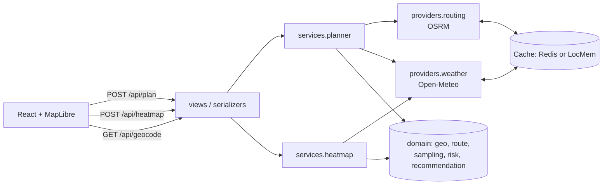

# Stormline — Weather-Aware Truck Routing

React + Django app that helps a truck driver pick the safest route by combining **routes**,
**hourly forecasts at the truck's ETA**, the **risk/load rules**, and **travel time**.

> **Live demo:** _add your Render URL_ · **Walkthrough:** _add your Loom link_

| | |
|---|---|
| **Routes** | 3 options per trip (OSRM alternatives, plus synthesized via-point alternatives when OSRM returns fewer) |
| **Checkpoints** | Every 10 / 25 / 50 mi plus the destination; ETA from the route's own per-segment time profile |
| **Weather** | Open-Meteo hourly forecast read at each checkpoint's ETA (wind at the nearest hour, precipitation for the hour being driven) |
| **Risk** | Wind / rain / snow thresholds plus load rules, implemented exactly as specified and unit-tested at every boundary |
| **Recommendation** | No Travel mi → Severe mi → High mi → average risk → travel time, with a sentence explaining what decided it |
| **Map** | All routes, risk-coloured road segments, checkpoints with ETA popups, route labels, origin/destination markers |
| **Heatmap** | Corridor grid with 0–48 h forecast slider and play button; Risk / Wind / Rain / Snow layers; a truck marker moves along the selected route in sync |

No API keys are needed: OSRM (routing), Photon (geocoding) and Open-Meteo (weather) are all keyless.

---

## Quick start

```bash
# Backend (Python 3.12)
cd backend
python -m venv .venv && .venv/Scripts/activate      # Windows; use `source .venv/bin/activate` on macOS/Linux
pip install -r requirements.txt
python manage.py runserver                          # http://127.0.0.1:8000

# Frontend (Node 20+)
cd frontend
npm install
npm run dev                                         # http://localhost:5173 (proxies /api to :8000)
```

Tests:

```bash
cd backend  && python -m pytest        # 91 tests: rules, sampling, ranking, providers (HTTP stubbed), API
cd frontend && npm test                # heatmap normalization + truck timeline
cd frontend && npm run typecheck
```

Production-style single service (Django serves the built SPA):

```bash
cd frontend && npm run build && cd ../backend && python manage.py runserver   # open http://127.0.0.1:8000
docker build -t stormline . && docker run -p 8000:8000 -e DJANGO_SECRET_KEY=x stormline
```

---

## Architecture



```
backend/routing/
  domain/           Pure Python, no Django, no I/O; fully unit-tested
    risk.py           Threshold bands + load rules → RiskAssessment (level, per-condition, drivers)
    route.py          Route model with a per-vertex distance AND time profile; truck speed cap
    sampling.py       Checkpoint placement, ETA per checkpoint, the stretch of road each one covers
    recommendation.py Exposure summary + lexicographic ranking + human-readable reason
    geo.py            Haversine, interpolation, Douglas-Peucker, proximity index
  providers/        Adapters that turn vendor JSON into domain objects
    routing.py        OSRM + alternative synthesis (slowdown / overlap / spur filters)
    weather.py        Open-Meteo: cell bucketing, per-(cell, day) cache, batched parallel fetch
    geocoding.py      Photon (built for type-ahead)
    http.py           Shared session: retries/backoff, timeouts, error mapping
  services/         Use-cases orchestrating providers + domain (providers are injected for tests)
    planner.py        geocode → routes → checkpoints → ONE weather call → risk → rank
    heatmap.py        Corridor grid generation + 49 hours of conditions/risk per grid point
  api/              DRF views, request validation, response presenters, error envelope
frontend/src/
  components/MapView.tsx   Imperative MapLibre: long-lived sources, paint-property updates only
  lib/heatmap.ts           Build heatmap GeoJSON once; slider swaps one expression
  lib/timeline.ts          Truck position at time t (binary search over the route timeline)
  hooks/useTripPlanner.ts  Plan → heatmap in sequence, stale requests aborted
```

---

## How the logic works (and the decisions behind it)

### 1. Routes
* OSRM is asked for `alternatives=3`. It often returns fewer, because it only returns paths that pass its own
  quality checks. To fill the gap, we route through **via-points pushed sideways** off the
  origin→destination chord (15–45% of its length, both sides). A candidate is kept only if it is:
  * at most **1.5× slower** than the fastest route,
  * at most **80% shared** with any route already chosen, measured by sampling the candidate every mile against the others,
  * free of **out-and-back spurs**, which happen when a via-point snaps onto a side road.
* If fewer than 3 distinct, reasonable routes exist (very short trips, islands), the UI says so instead of
  showing near-duplicates.

### 2. ETA at each checkpoint
* OSRM's per-segment `annotations` (distance and duration) build a **time profile along the route**, so a
  checkpoint after a slow city stretch gets a later ETA than a constant average speed would give.
* OSRM's public server only has a car profile, so every segment is **capped at a truck speed**
  (`TRUCK_MAX_SPEED_MPH`, default 65). If annotations don't align with the geometry, the route falls back to
  spreading total duration by distance (also capped).

### 3. Checkpoints and "miles"
* Checkpoints sit at 0, N, 2N, … miles and at the destination. Each one **covers the road from the midpoint
  with its previous neighbour to the midpoint with its next**. Coverage sums exactly to route length for every
  interval, so "Severe miles" is comparable across routes and across 10/25/50 mi sampling.

### 4. Weather at the ETA
* Open-Meteo hourly data, in mph and inches. Rain is `rain + showers`; snow is `snowfall`. Units are verified
  from `hourly_units`, never assumed.
* **Time semantics.** Wind is an instantaneous value at the hour mark, so we read the **nearest hour**.
  Rain and snow are **totals over the preceding hour**, so for a truck passing at 13:20 we read the 14:00 value,
  which covers 13:00–14:00. That is exactly the in/hr rate for the hour the truck is driving.
* **Efficiency.** Points are bucketed into `WEATHER_CELL_DEG` cells (0.25°, about 17 mi). Forecasts are cached per
  (cell, UTC day) for an hour in a cache shared by all worker processes (Redis if `REDIS_URL` is set, otherwise
  files on local disk). Missing cells are fetched 100 locations per request with 4 requests in parallel, and every
  checkpoint on all 3 routes resolves in **one batched weather pass**. Re-sampling at a different interval or
  changing the load usually needs **zero** new weather calls.
* **Free-tier quota.** Open-Meteo's free tier allows about 600 locations/minute per IP. 0.25° matches the GFS
  model grid and keeps the worst case, a Los Angeles → New York plan plus heatmap, at about 450 lookups. If the
  per-minute quota is still hit (hosting platforms share outbound IPs), the backend waits and retries up to
  twice instead of failing. Hourly and daily quota errors fail fast with a message naming the quota. With a
  commercial key, set `OPEN_METEO_API_KEY` and `WEATHER_CELL_DEG=0.1`.

### 5. Risk rules (`domain/risk.py`)
| Condition | Low | Moderate | High | Severe | No Travel |
|---|---|---|---|---|---|
| Wind (mph) | < 25 | 25–34 | 35–44 | 45–54 | **≥ 55** |
| Rain (in/hr) | < 0.10 | 0.10–0.25 | 0.25–0.50 | 0.50–1.00 | **> 1.00** |
| Snow (in/hr) | < 0.5 | 0.5–1.0 | 1.0–2.0 | 2.0–3.0 | **> 3.0** |

* Boundaries: each band's **lower bound is inclusive** (25.0 mph is Moderate; 0.25 in/hr is High). Wind No
  Travel is inclusive (≥ 55); rain and snow No Travel are strict (> 1.00, > 3.0), exactly as written.
* Load rules escalate the wind level only and never lower it:
  45–54 mph with **> 30,000 lb** → No Travel; 35–44 mph with **> 40,000 lb** → Severe. A load of exactly 30,000 or
  40,000 lb does not trigger them ("greater than").
* Checkpoint level = worst of wind, rain, snow. The UI shows which condition drove it and whether a load rule applied.

### 6. Recommendation (`domain/recommendation.py`)
Lexicographic, in the order the spec gives: **Severe miles → High miles → average risk → travel time**,
with **No Travel miles added in front**. Without that extra key, a route crossing a No Travel wind corridor
could beat a route with a few Severe miles, because it technically has "fewer Severe miles".
* Average risk is the distance-weighted mean of level scores (Low 0 … No Travel 4).
* Miles are compared at 0.1 mi and average risk at 0.01, so floating-point noise never decides the outcome.
* The response says **which criterion decided** it and why, e.g. *"Fewest Severe miles: 0.0 mi vs 25.0 mi
  on the next-best route."* It adds advisories when even the best route has Severe or No Travel stretches.

### 7. Heatmap and UI performance
* The backend builds a **regular grid within a 25–50 mi buffer around each route**. Routes are buffered
  separately, so the gap between widely separated alternatives isn't filled. Grid spacing is the finest multiple
  of the weather cell that keeps ≤ 160 points, so each grid point is a cached forecast cell.
* All **49 hours × 4 metrics** ship in one gzip-compressed response. The frontend builds the GeoJSON **once**,
  pre-normalizing every hour/metric into feature properties. **Moving the slider changes a single
  `heatmap-weight` expression**: no data upload, no React re-render of map layers. All 49 slider steps take
  about 1.5 s in headless Chrome, including the automation round-trips.
* Every metric is mapped onto a **shared risk scale** (Moderate 0.25, High 0.5, Severe 0.75, No Travel 1.0)
  using its own thresholds, so orange means "High" whether you're viewing wind, rain or snow.
* The slider is anchored to the exact departure time. The truck marker shows where the selected route's truck
  is at that hour, using the same time profile as the checkpoint ETAs, so you can see whether the truck meets
  the storm.
* Map layers are WebGL (MapLibre). Selection and slider changes update long-lived sources and paint properties
  and never re-create layers. The map is code-split into its own cacheable chunk.

---

## API

| Method | Path | Body / query | Notes |
|---|---|---|---|
| GET | `/api/health` | | liveness |
| GET | `/api/geocode?q=denver` | | suggestions `{results: [{label, lat, lon}]}` |
| POST | `/api/plan` | `{origin, destination, departure, load_weight_lbs, interval_miles}` | `origin`/`destination` may be `{label, lat, lon}` or free text |
| POST | `/api/heatmap` | `{corridor: [[[lon,lat],…] per route], departure, load_weight_lbs, hours?}` | 0–48 h grid |

Errors use one envelope, `{"error": {"code", "message", "details?"}}`:
* 400: validation (bad interval, negative load, departure in the past or more than 7 days ahead)
* 422: unknown place or no drivable route
* 429: API rate limit
* 502: upstream provider failure, including the weather provider's own rate limit, with a clear message

---

## Deploy

* **Render (one click):** New → Blueprint → select this repo. `render.yaml` builds the `Dockerfile`, which
  builds the React app and serves it from Django with WhiteNoise. One origin, no CORS.
* **Split hosting** (e.g. Vercel + Render): build the frontend with `VITE_API_URL=https://your-api`, and set
  `CORS_ALLOWED_ORIGINS` on the backend.
* With more than one worker, set `REDIS_URL` so the route and weather caches are shared.

See `.env.example` for every setting.

---

## Assumptions and limitations

* **Truck routing profile.** Public OSRM is car-only: no bridge-height, weight-limit or hazmat restrictions.
  The routing adapter is the only thing to swap for ORS `driving-hgv`, HERE or Trimble.
* **Wind** uses sustained 10 m wind, as the table implies. Gusts are shown alongside it, and would be a one-line
  change in `risk.assess` if the rules should use them.
* **Hours of service.** ETAs assume continuous driving. Adding FMCSA HOS breaks (a 30 min break after 8 h, a
  10 h rest after 11 h) would plug into `domain/route.py` as extra dwell time.
* Departure is limited to the next 7 days so the whole trip stays inside the 16-day forecast horizon.
* Public OSRM, Photon and Open-Meteo are fair-use services. Production use needs self-hosting or keys.

## Loom walkthrough outline (5–10 min)
1. Problem framing and a live run of Denver → Chicago at 35k lb: 3 routes, recommendation reason, checkpoint popups.
2. Switch to 45k lb and a windy day: load rules escalate wind and the recommendation changes.
3. Scrub and play the heatmap; switch Risk/Wind/Rain/Snow; the truck marker meets (or misses) the weather.
4. Code tour: `risk.py` and its boundary tests → `sampling.py` (coverage, ETA) → `recommendation.py` → `planner.py`.
5. Performance: one batched weather pass, the cache, and the slider as a single paint-property swap.
6. Trade-offs and next steps (truck profile, HOS breaks, gust policy).
